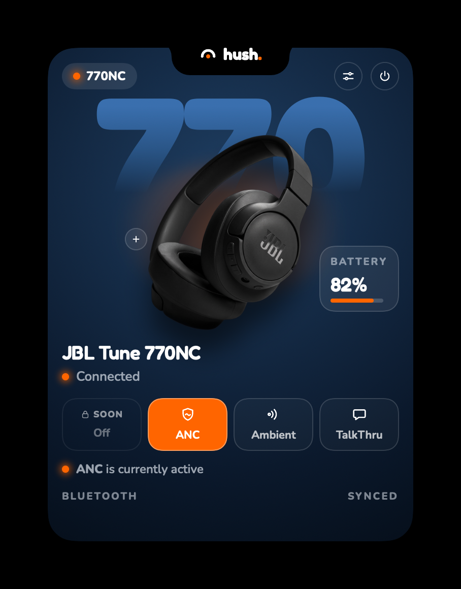
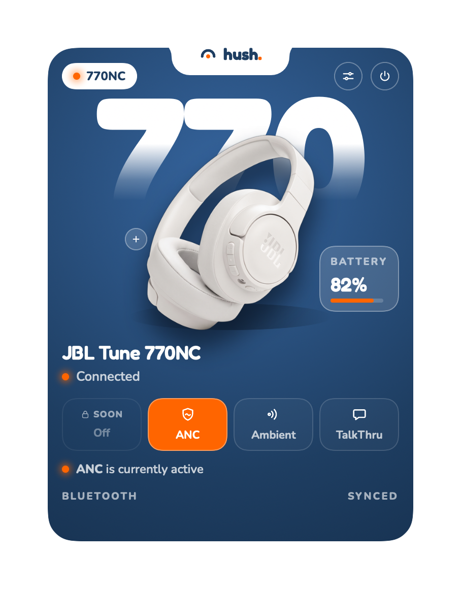
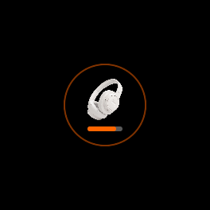
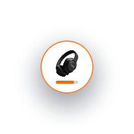
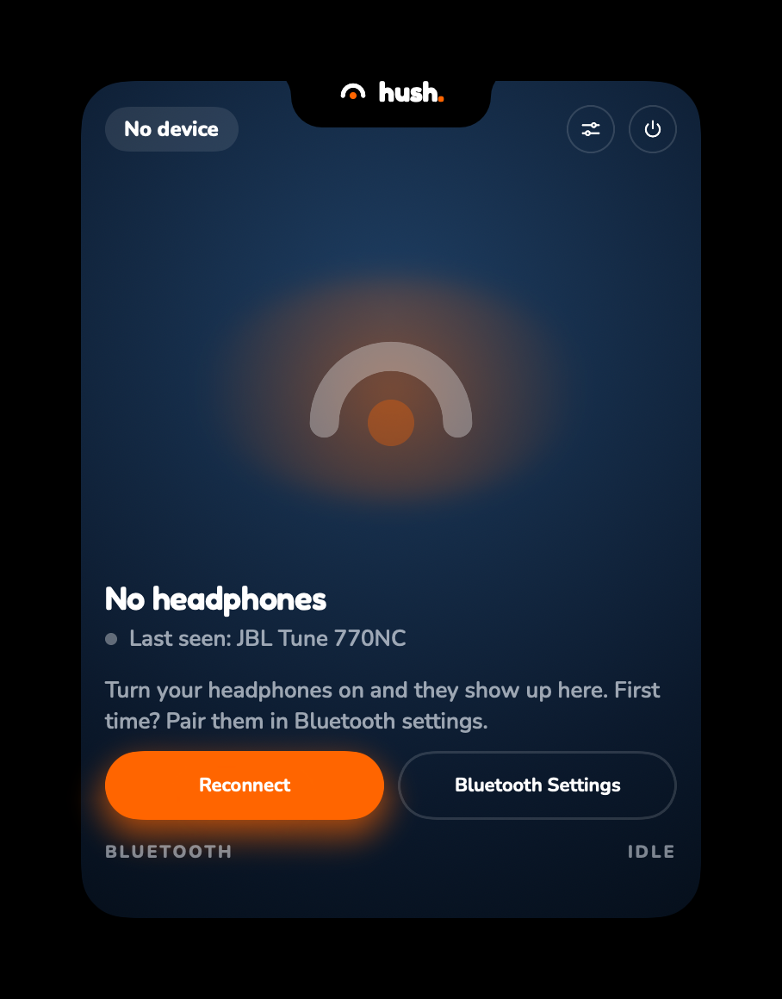

# hush.

A free, open-source macOS menu bar app for JBL Tune headphones (770NC / 670NC). A small pill
lives at the edge of your screen — click it and it expands into a card showing your headphones'
battery and letting you switch noise-control modes (ANC / Ambient / TalkThru), all without opening
Bluetooth settings or a phone app.

<p align="center">
  
  
</p>
<p align="center">
  
  
  
</p>

These are real renders of the live app (via the project's own snapshot harness — see
[Previewing every visual state](#previewing-every-visual-state)), not mockups.

## Why this exists

JBL's own app is a phone app. There's no first-party way to see your Tune 770NC/670NC's battery
or switch ANC/Ambient/TalkThru from a Mac. Hush talks to the headphones directly over Bluetooth —
noise-mode control over classic Bluetooth (RFCOMM), battery over BLE — and gets out of the way the
rest of the time: no Dock icon, no main window, just a pill docked to a screen edge.

## Features

- **Noise-mode control** — switch between ANC, Ambient, and TalkThru from the menu bar. A mode is
  only ever shown as active once the headphones themselves confirm it with a real status event —
  never optimistically, and never just because a command was accepted.
- **Live battery** — read over BLE (Battery Service 0x180F), shown as a percentage and a bar in
  both the pill and the expanded card, with a distinct low-battery treatment under 15%.
- **Honest connection states** — "No headphones" (with a one-click Reconnect / Bluetooth Settings
  pair), "Connecting…", "Controls not available for this model yet" (for a matched but
  not-yet-wired-up model), and low battery all get their own clear UI state, not a single
  everything-looks-fine screen.
- **Pending/timeout handling** — tap a mode and it shows a pending ring. If the headphones don't
  confirm within 2 seconds, the button shakes, returns to available, and the previous mode stays
  active — the app never silently assumes a command worked.
- **Docks to any screen edge** — top, bottom, left, or right, with an adjustable distance from the
  edge and pill diameter (Island Settings). Collapses to a small pill when not in use; the panel
  never steals focus.
- **Menu bar icon reflects live state** — a different glyph for ANC / Ambient / Off / no device,
  so you can tell what's active without opening the tray.
- **Light and dark themes**, matched to the system appearance, with every visual state built with
  SwiftUI previews for both.
- **Debug tooling** (Debug builds only) — a "Send test frame…" menu to probe real RACE frames by
  hand, and "Copy Diagnostics" to grab a full connection/state dump for bug reports.

### What it deliberately does *not* do

- It never turns a 5B *acknowledgement* into "mode is active" on its own — only a 5C *status
  event* does that. An accepted-but-unconfirmed command is shown as pending, then times out.
- It never sends a single byte to any device other than a matched JBL Tune 770NC/670NC. An
  unrecognized or unverified device gets no write allowlist at all (see
  [Safety model](#safety-model) below).
- Off has no working command on either model — no command frame for it has ever been captured
  from real hardware, so its button is shown disabled ("SOON") rather than faked.

## Supported devices

| Model | Noise control | Battery | Status |
|---|---|---|---|
| JBL Tune 770NC | ANC, Ambient, TalkThru (Off not yet captured) | ✅ | Hardware-verified |
| JBL Tune 670NC | ANC, Ambient, TalkThru (Off not yet captured) | ✅ | Hardware-verified |
| Any other JBL headset | — | — | Shows a generic "Unknown Headphones" state with no controls; safe by construction (see below) — never sends it anything |

Adding a new model is a matter of writing a new `DeviceProfile` conformer (see
[Architecture](#architecture)) — contributions for other JBL models are very welcome.

## Installing

1. Download the latest `Hush-X.Y.Z.dmg` from the [Releases page](../../releases).
2. Open the DMG and drag **Hush.app** into **Applications**.
3. First launch: macOS will warn that it's from an unidentified developer (the build isn't
   notarized — see [Code signing](#code-signing--distribution) below). Right-click the app →
   **Open** → **Open** again to confirm. You only need to do this once.
4. Grant the Bluetooth permission prompt when it appears.
5. Hush appears as a small pill at the top edge of your screen. Click it to expand.

### Code signing & distribution

Hush is built and distributed **ad-hoc signed** (no Apple Developer Program membership behind
this project) — that's the one-time Gatekeeper prompt above. The app is fully open source, so you
can always build and sign it yourself instead; see [Building from source](#building-from-source).

Every tagged release (`vX.Y.Z`) is built, tested, and published automatically by
[`.github/workflows/release.yml`](.github/workflows/release.yml) — nothing is hand-uploaded.

## Architecture

```
JBLCompanion/
├── App/          AppDelegate, app entry point, the dev-only snapshot harness
├── Bluetooth/    Classic (RFCOMM/RACE) + BLE (battery) transport, safety gates
├── Profiles/     Per-model DeviceProfile conformers (what's verified on real hardware)
├── State/        HeadphoneState — the single source of truth the UI renders from
└── UI/           SwiftUI views (pill, card, settings) + pure view-state resolvers
```

### Two independent Bluetooth links

- **Classic Bluetooth (IOBluetooth), RFCOMM channel 21** — the device's SDP-advertised
  `Airoha_APP` service, carrying the **RACE** control protocol (`05 5x ...` frames). This is
  where noise-mode commands go out and status events come back. There is no BLE path for this —
  an early attempt to write mode commands over a BLE GATT characteristic ran into an encrypted
  link this Mac never bonded, and the classic path turned out to carry the identical frame
  grammar with no such friction.
- **BLE (CoreBluetooth)** — used for exactly one thing: reading and subscribing to the standard
  Battery Service (`0x180F`) / Battery Level characteristic (`0x2A19`). The headphones' BLE
  identity is found by advertised name + service UUID (never by address, which rotates).

`ClassicConnectionMonitor` watches for a matching device connecting/disconnecting (by name, via
`DeviceProfileMatcher` — never a hard address requirement, so an unrecognized unit of a known
model is still picked up), and a short poll-with-backoff catches a device that was already
connected before the app launched (IOBluetooth has no notification for that case).

### Device profiles

Everything model-specific — which frame does what, which modes are actually confirmed to work,
what the headphones look like, whether a 0% battery reading should be trusted — lives in one
`DeviceProfile` conformer per model
([`Tune770NCProfile`](JBLCompanion/Profiles/Tune770NCProfile.swift),
[`Tune670NCProfile`](JBLCompanion/Profiles/Tune670NCProfile.swift)), never hardcoded into a view.
A profile declares, per noise mode, whether it's `isModeVerified` — independently confirmed on
real hardware, not just carried over from a similar model's assumed mapping — and the UI reads
*only* that flag to decide what's tappable. `GenericProfile` is the deliberately locked-down
fallback: empty write allowlist, noise control marked unsupported, used as the "nothing verified
at all" baseline in tests.

### Safety model

Every byte this app can ever send to the headphones goes through the same narrow gate, regardless
of which UI path triggered it:

1. **`WriteGuard`** — an allowlist-only gate. A write is only ever permitted if it's an *exact*
   byte-for-byte match against an entry the connected device's own `DeviceProfile` supplies. An
   unmatched or unverified device has an empty allowlist, which rejects every write
   unconditionally — there's no "write anyway, just log it" fallback.
2. **`NoiseControlCommander`** — enforces a minimum 500 ms interval between writes and refuses to
   send anything the connected profile hasn't independently verified actually works on real
   hardware (`isModeVerified`), on top of the `WriteGuard` check.
3. **`NoiseModeRequestCoordinator`** — tracks a sent-but-unconfirmed command and gives it exactly
   2 seconds to be confirmed by a real status event before the UI reverts (shake, button back to
   available, previous mode stays active).

This is also why the app's menu bar status line distinguishes *mode is active* (a real 5C status
event arrived) from merely *unverified* — the eventMap confirming which byte means which mode is
itself a per-profile flag (`eventMapVerified`), separate from whether writing a given mode's
command is verified to work at all.

### The pill / card UI

`NotchPanel` is a borderless, non-activating `NSPanel` hosting a native CAShapeLayer silhouette
(`NotchSilhouetteView`) with SwiftUI content (`NotchView`) layered on top — the pill is always
mounted (never inserted/removed via SwiftUI transitions, which was a real source of flicker during
development), just hidden with an unanimated opacity flip the instant the card is about to cover
it. `CardConditionResolver` is a small pure function that turns the handful of raw signals
(classic connection, whether any status event has arrived yet, battery, whether this model's
controls actually work) into one of five conditions — `.noDevice`, `.connecting`,
`.controlsUnavailable`, `.lowBattery`, `.connected` — which is the only thing `ExpandedCard`
switches its layout on.

### Previewing every visual state

`PreviewSnapshotHarness` (Debug-only) renders every meaningful pill/card state — both themes,
every dock edge, every condition above — headlessly to PNG, for comparing against the design
reference without needing Xcode's interactive canvas:

```sh
JBL_SNAPSHOT_DIR=/tmp/hush_snapshots path/to/Hush.app/Contents/MacOS/Hush
```

The app detects `JBL_SNAPSHOT_DIR`, renders every scenario, and exits immediately — no real
Bluetooth/UI session starts. This is also how the screenshots at the top of this README were made.

## Building from source

Requirements: Xcode 16+, macOS 14+ deployment target, [XcodeGen](https://github.com/yonaskolb/XcodeGen).

```sh
brew install xcodegen
git clone https://github.com/davedumto/Hush.git
cd Hush
xcodegen generate
open JBLCompanion.xcodeproj
```

`project.yml` is the single source of truth for the Xcode project — never edit
`JBLCompanion.xcodeproj` directly (it's git-ignored and regenerated by `xcodegen generate`; the
project file itself keeps its original internal name even though the built app is `Hush.app`).

Build and test from the command line:

```sh
xcodebuild -project JBLCompanion.xcodeproj -scheme JBLCompanion -configuration Debug build
xcodebuild -project JBLCompanion.xcodeproj -scheme JBLCompanion -destination 'platform=macOS' test
```

### Building a DMG yourself

```sh
scripts/build_dmg.sh [version]
```

Builds a Release configuration and packages it into `Hush-<version>.dmg` (ad-hoc signed, same as
the published releases). `version` defaults to `project.yml`'s own `MARKETING_VERSION`. This is
the exact script `.github/workflows/release.yml` runs on every tagged push.

## Testing

256 tests across pure-logic Swift files — protocol framing, write-allowlist behavior, connection
state resolution, geometry/placement math, device matching, and more. Every pure function gets
unit tests; every visual state gets a SwiftUI preview in both light and dark. Bluetooth transport
code that genuinely can't be unit-tested without real hardware (the IOBluetooth/CoreBluetooth
delegate glue itself) is kept as thin as possible, with the actual decision logic it calls into
extracted into plain, tested functions.

```sh
xcodebuild -project JBLCompanion.xcodeproj -scheme JBLCompanion -destination 'platform=macOS' test
```

All tests must pass before a commit lands.

## Contributing

Contributions are very welcome — a new device profile for another JBL model, a bug fix, a UI
polish pass, anything.

- **Found an issue?** Open a GitHub issue. If it's a protocol/hardware question (a new RACE frame,
  a model that doesn't match), include what you captured and how (a Bluetooth packet log, the
  `jbl-recon` approach described in the profile files' comments, etc.) — "I think this is the
  frame" without verification won't get marked as verified in a `DeviceProfile`.
- **Adding a new device model?** Write a new `DeviceProfile` conformer
  ([`DeviceProfile.swift`](JBLCompanion/Profiles/DeviceProfile.swift) documents every requirement).
  Only mark `isModeVerified`/`eventMapVerified` true for something you've actually confirmed on
  real hardware — this project takes "verified" literally; a plausible guess carried over from a
  similar model is exactly the kind of thing that caused real bugs here before (see
  `NoiseControlCommander.commandFrame`'s own history: two modes' command frames were mislabeled
  from an initial capture and only caught once someone actually tested each one against real
  audio behavior).
- **Opening a PR:**
  - Run `xcodegen generate` after any `project.yml` change, and commit the regenerated files it
    touches.
  - All tests must pass (`xcodebuild ... test`) before you open the PR.
  - Any new pure logic should come with unit tests; any new visual state should come with a
    SwiftUI preview in both light and dark.
  - Never hardcode per-model behavior into a view — it belongs on a `DeviceProfile`.
  - Conventional commit messages (`fix:`, `feat:`, `refactor:`, `docs:`, ...).

No contribution guidelines beyond the above are required to get started — open an issue first if
you want feedback on an approach before investing time in a larger change.

## License

Apache License 2.0 — see [LICENSE](LICENSE). Use it, fork it, ship your own build of it.

## Disclaimer

This is an independent, unofficial project with no affiliation to JBL, Harman, or Samsung. It was
built entirely from observing this app author's own headphones' real Bluetooth traffic — not from
any JBL documentation or SDK. "Verified" in this codebase always means "confirmed against the
author's own real JBL Tune 770NC/670NC hardware," not "officially documented behavior." Use at
your own risk; this project sends real commands to real Bluetooth hardware.
